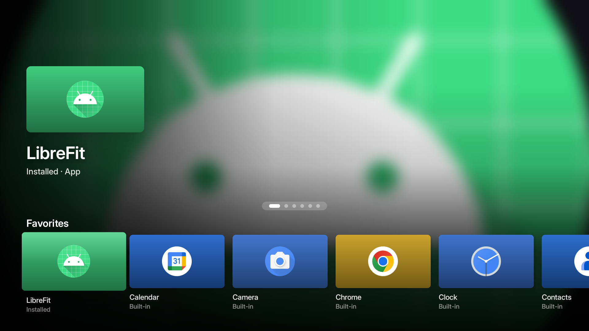
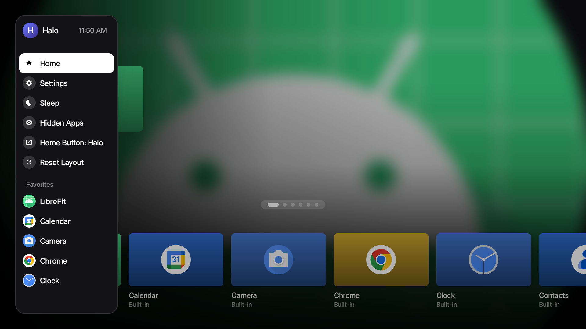
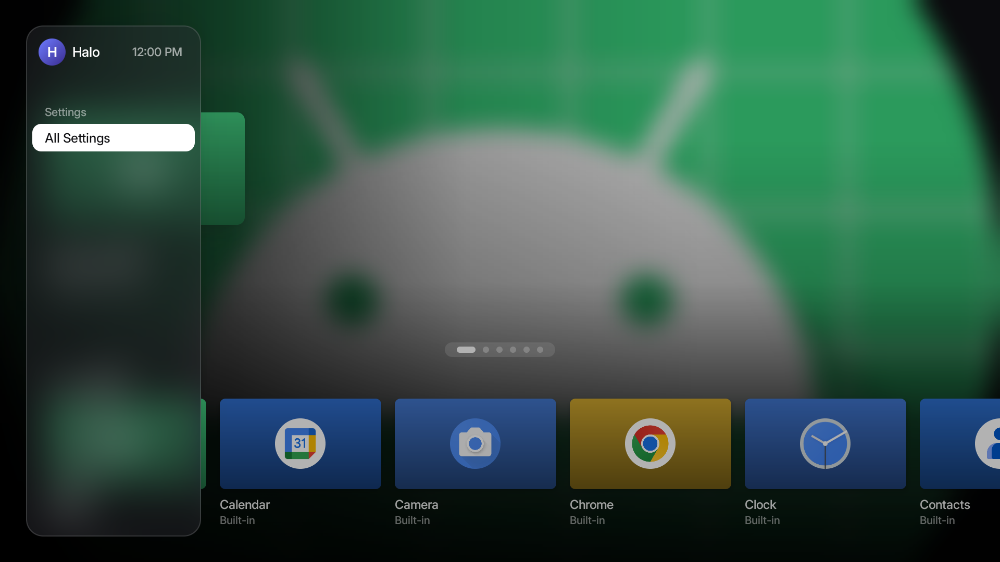
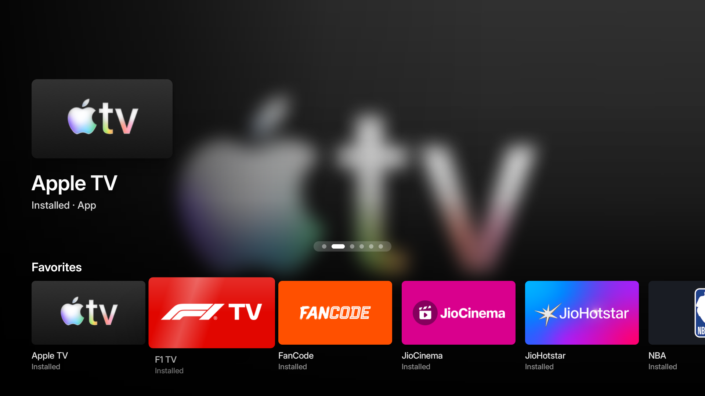

# Halo

An ad-free home screen for Android TV and Fire TV, written in plain Java with no third-party libraries.



> **Status: experiment.** Halo works as an app launcher on Fire TV, but Fire OS will not let it
> replace Amazon's home screen. See [NOTES.md](NOTES.md) for what worked, what didn't, and why.
> On Android TV devices that let you pick a default home app (e.g. Nvidia Shield, onn. 4K) it can
> be the real home screen.

## What it does

- **Full-screen hero** for the focused app: a blurred, slowly drifting backdrop made from the app's
  own banner, with its title and a subtitle (where it came from, when you last opened it).
- **Rows that scroll sideways**: Favorites, Your Apps, and Amazon & Built-in apps, with the next
  tile peeking in from the edge.
- **Focus motion**: tiles lift, tilt toward the direction you moved, and catch a light sweep,
  using a spring curve.
- **Frosted-glass sidebar** (press Back on the top row, or Left from the first tile): Home,
  Settings, Sleep, Mirroring, Hidden Apps, Home Button setup, Reset Layout, and your Favorites.
- **Per-app options** (hold OK or press Menu): move within Favorites, add/remove from Favorites,
  hide, App Info, Uninstall.
- **Inter** typeface (SIL Open Font License, see `FONT-LICENSE-Inter.txt`).
- **No network access, no analytics.** About 115 KB as a release APK.

| Sidebar | Settings menu | On a Fire TV Stick |
|---|---|---|
|  |  |  |

## Build

Needs JDK 17 and the Android SDK (compileSdk 36). Min SDK 22, target SDK 34.

```bash
./gradlew assembleRelease
```

The APK is written to `app/build/outputs/apk/release/app-release.apk`. The release build is signed
with your local debug key, which is fine for sideloading.

## Install on a Fire TV Stick

1. **Settings → My Fire TV → About**: click the device name 7 times to unlock Developer Options.
2. **Settings → My Fire TV → Developer Options**: turn on **ADB Debugging**.
3. Find the stick's IP: **Settings → My Fire TV → About → Network**.
4. From your computer (approve the prompt on the TV):

```bash
adb connect <FIRE-STICK-IP>:5555
adb install -r app/build/outputs/apk/release/app-release.apk
adb shell am start -n dev.halo.launcher/.MainActivity
```

### Optional: make the Home button come back to Halo

Fire OS doesn't let you change the default launcher. Halo includes an accessibility service that
watches for Amazon's home screen and opens Halo when it appears. It cannot read screen content.

```bash
adb shell settings put secure enabled_accessibility_services dev.halo.launcher/dev.halo.launcher.HomeRedirectService
adb shell settings put secure accessibility_enabled 1
```

Expect Amazon's home screen for **about 5 seconds** after each Home press: Fire OS holds back
other apps for that long (details in [NOTES.md](NOTES.md)). The same service powers **Sleep** in
the sidebar.

Turn it off again:

```bash
adb shell settings put secure enabled_accessibility_services null
```

### Uninstall

```bash
adb shell settings put secure enabled_accessibility_services null
adb uninstall dev.halo.launcher
```

## Code map

| File | What it does |
|---|---|
| `MainActivity.java` | Layout, hero, rows, focus motion, sidebar and panels, Settings menu |
| `AppRepo.java` | Finds launchable apps (TV banners first), saves Favorites and hidden apps |
| `Blur.java` | Box blur, dominant-color extraction, tile gradients (pure Java, works on Android 5.1+) |
| `GlassDrawable.java` | Frosted-glass background from a blurred snapshot |
| `Spring.java` | Damped-spring animation curve |
| `HomeScroll.java`, `HRow.java` | Scroll views that only move when Halo animates them |
| `HomeRedirectService.java` | Fire TV Home-button redirect and Sleep |

## Not affiliated

Halo is an independent project, not affiliated with Amazon or Apple. It borrows general TV-UI
patterns (big hero, sideways rows, focus lift) but no assets, icons or fonts from either.

## License

Halo's code is released under the [MIT License](LICENSE). The bundled Inter font is under the
SIL Open Font License (see `FONT-LICENSE-Inter.txt`).
